# Database architecture

The schema is in `server/db/schema.sql` and covers all four phases from the start, so later phases add features without restructuring existing data. Each phase only *uses* more of it.

## The core idea

Everything revolves around four record types:

- **People** (`users`): every person who signs in, whether owner, manager, employee or subcontractor. One table with a `role` column, so permissions, assignments, time records and audit entries all point at the same `users.id`.
- **Customers** (`customers`): the farms and businesses you work for.
- **Jobs** (`jobs`): a piece of work for a customer. Jobs connect people, equipment, time and documents.
- **Assets** (`inventory_items`): machines (equipment) and stock (consumables) in one table, split by `kind`.

Time records, inventory movements, maintenance, inspections, documents and the audit log are all **history attached to those four**.

## How the main records relate

```mermaid
erDiagram
    users ||--o| employee_profiles : "has HR profile"
    users ||--o{ pay_rates : "rate history"
    users ||--o{ certifications : holds
    users ||--o{ availability : "weekly availability"
    users ||--o{ time_off_requests : requests
    users ||--o{ sessions : "signed-in devices"

    customers ||--o{ jobs : "work for"
    jobs ||--o{ job_assignments : crew
    users ||--o{ job_assignments : "assigned to"
    jobs ||--o{ job_equipment : machines
    inventory_items ||--o{ job_equipment : "used on"
    jobs ||--o{ job_notes : notes

    users ||--o{ time_entries : "clocks"
    jobs ||--o{ time_entries : "time charged to"
    time_entries ||--o{ time_breaks : breaks
    time_entries ||--o{ time_entry_revisions : "correction history"
    users ||--o{ timesheets : "one per week"

    inventory_items ||--o{ inventory_movements : "quantity history"
    jobs ||--o{ inventory_movements : "materials used"
    inventory_items ||--o{ maintenance_records : "issues & repairs"
    inventory_items ||--o{ maintenance_schedules : "recurring service"
    inspection_templates ||--o{ inspections : "filled in as"
    inspections ||--o{ inspection_responses : answers
    inspections ||--o{ maintenance_records : "failed items open"

    documents ||--o{ document_versions : versions
    files ||--o{ document_versions : stored
    documents ||--o{ document_links : "linked to job/person/customer/item"
    documents ||--o{ signature_requests : "sent for signing"
    files ||--o{ attachments : "photo/file on any record"

    users ||--o{ audit_log : "made change"
```

### In plain terms

| Relationship | How it's stored | Why |
|---|---|---|
| A person has one HR profile | `employee_profiles.user_id` → `users.id` (1:1) | Keeps login/security fields separate from HR details |
| A person's pay rate changes over time | `pay_rates` rows with `effective_from` | Last year's labor costs stay correct after a raise |
| A job belongs to one customer | `jobs.customer_id` | A customer has many jobs |
| Many people work many jobs | `job_assignments (job_id, user_id)` | The crew list. Also decides which jobs an employee can see. |
| Many machines go to many jobs | `job_equipment (job_id, item_id)` | Equipment in use, scheduling conflicts, job costing |
| A shift belongs to one person and (optionally) one job | `time_entries.user_id`, `time_entries.job_id` | "No job" means shop/general time. A job's actual hours are the sum of its entries. |
| Corrections never overwrite | `time_entry_revisions` (append-only, enforced by triggers) | Original value, new value, who, when, why |
| One timesheet per person per week | `timesheets UNIQUE (user_id, week_start)` | Approval status and lock. Entries are matched to it by date, not copied. |
| Every stock change is a row | `inventory_movements` (append-only) | `inventory_items.quantity` is the running total; movements are the proof |
| Photos/files can attach to anything | `attachments (entity_type, entity_id, file_id)` | One upload system for jobs, people, customers, items, repairs and inspections |
| Every important change | `audit_log` (append-only) | Activity feeds and the owner's audit history |

### Rules the database itself enforces

These are enforced as database constraints, so a bug in application code cannot break them:

- **Unique records:**
  - one account per email
  - one active customer per name
  - unique job numbers, asset numbers and barcodes
  - one timesheet per person per week
- **Time rules:**
  - at most **one open shift per person** (partial unique index)
  - at most one open break per shift
  - a clock-out must be after its clock-in
- **Valid values:** statuses, roles and job types are restricted by CHECK constraints.
- **Append-only history:** `audit_log`, `time_entry_revisions` and `inventory_movements` reject UPDATE and DELETE (triggers).
- **No orphans:** foreign keys are enforced, so for example a time entry can't point at a job that doesn't exist.

### How data shows up everywhere it's used

Names, statuses and totals are never copied into other tables. They're **joined at read time**, so a change appears everywhere immediately:

- Rename a customer, and every job list, dashboard card and report shows the new name.
- Correct a shift, and the job's actual hours, the employee's weekly total, the dashboard and the labor report all update.

There are two deliberate exceptions, where history must *not* change:

- **Inspections** keep a snapshot of the checklist wording.
- **Approved timesheets** keep `approved_minutes` as a record of what was approved.

### Deleting

Records that matter are never hard-deleted. Instead:

- people become **inactive**
- customers and documents are **archived**
- shifts are **voided**, with a reason
- equipment is **retired**

History remains intact and reports stay accurate.

### Times and money

- **Instants** (clock punches, created-at): UTC ISO-8601.
- **Calendar dates** (time off, week starts): `YYYY-MM-DD` in the **company time zone** (Settings).
- **Money:** integer cents. **Quantities:** decimals.

## Which phase uses which tables

| Phase | Tables used |
|---|---|
| 1 Core operations | users, sessions, employee_profiles, pay_rates, certifications, availability, time_off_requests, customers, jobs, job_assignments, job_notes, time_entries, time_breaks, time_entry_revisions, timesheets, payroll_exports, settings, audit_log, files, attachments |
| 2 Equipment & inventory | inventory_items, inventory_movements, job_equipment, maintenance_records, maintenance_schedules |
| 3 Documents & inspections | document_folders, documents, document_versions, document_links, document_access, signature_requests, signature_signers, signature_events, inspection_templates, inspection_template_items, inspections, inspection_responses |
| 4 Reporting & integrations | reporting reads all of the above. integration_connections and external_refs hold the QuickBooks links. |

`locations` exists so jobs, people and inventory can later be split by yard or branch without migrating existing data.
